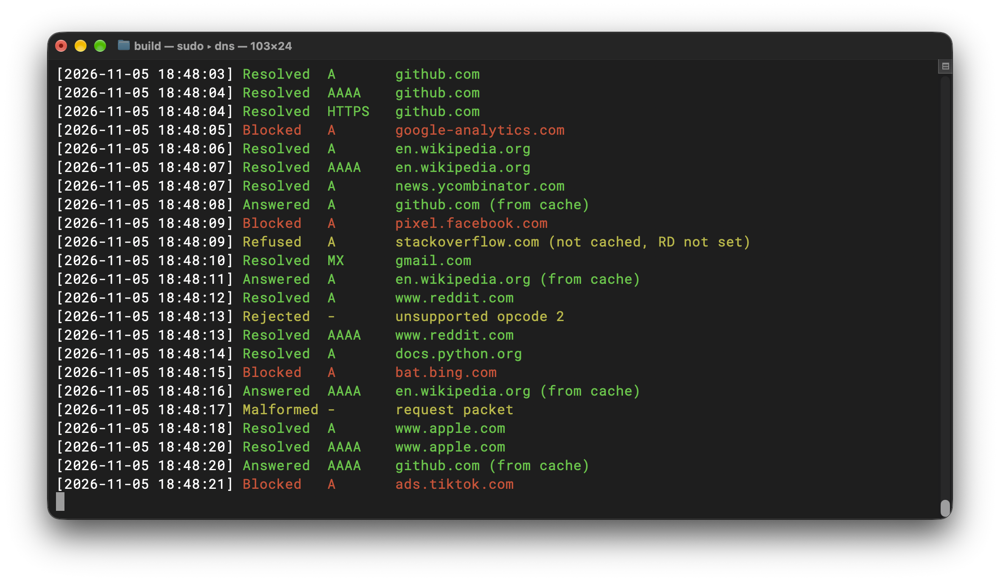

# RaphDNS: a Recursive DNS Resolver



## Features
- Written from scratch in C, with no external libraries
- Resolves from the root servers, with no upstream provider like 1.1.1.1
- Blocks ads, trackers and malware using a list of around 250,000 domains
- Caches answers until their TTL expires
- Handles many lookups at once on a single thread
- Logs every query with `-v`, colour-coded by outcome

## How it works

When a query arrives, the server checks the blocklist, then the cache, and only then starts a lookup from the root.

**Packet parsing:** A bounds-checked bit reader and writer handle the DNS wire format, so malformed packets are rejected rather than read out of bounds. Compression pointers are followed with a jump limit, which stops a crafted packet from causing an infinite loop.

**Recursive resolution:** Each lookup moves from the root to the TLD to the authoritative server, trying the next server on a timeout or error. It also follows CNAME chains and resolves nameservers that arrive without glue records as child lookups. A query budget shared across each lookup stops circular dependencies from recursing forever.

**Event loop:** A single thread uses `poll()` and non-blocking sockets to handle many lookups at once, so a slow nameserver never holds up other clients. In-flight queries are kept in a fixed-size table, each with its own timeout. Replies are only accepted if the query ID, source address and question all match, which makes spoofing harder.

**Cache:** A chained hash table using FNV-1a, which grows as it fills. Entries are keyed on name, type and class, ignoring case in the name. TTLs count down while a response is cached, and expired entries are evicted during lookups.

**Domain blocking:** Blocklists are loaded at startup into an open-addressing hash table. Each lookup checks the name and all of its parent domains, so blocking `example.com` also blocks `ads.example.com`. CNAME targets are checked too, which catches trackers hidden behind a first-party subdomain. Blocked names get an `NXDOMAIN` response.

## Getting started

Requires CMake 4.3+ and a C17 compiler. Developed and tested on macOS.

```sh
cmake -S . -B build
cmake --build build
sudo ./build/dns    # Port 53 requires root
```

Then, from another terminal:

```sh
dig @127.0.0.1 example.com
```

### Options

| Option         | Description                                               | Default     |
|----------------|-----------------------------------------------------------|-------------|
| `-v`           | Log every query                                           | Off         |
| `-p [port]`    | Port to listen on                                         | `53`        |
| `-b [address]` | IPv4 address to bind to. Use `0.0.0.0` for all interfaces | `127.0.0.1` |
| `-h`           | Show usage and exit                                       |             |

Any file placed in `blocklists/` is loaded at startup, with one domain per line and `#` for comments.

## Performance

Measured on an Apple M4 Pro with the client and server on the same machine, over loopback, with query logging off:

| Measurement                               | Result                              |
|-------------------------------------------|-------------------------------------|
| Cached lookup (p50, one client)           | ~25 µs                              |
| Cached throughput (10 clients, 30 s runs) | ~100,000 queries/sec on one thread  |
| Uncached lookup                           | ~85–260 ms, depending on the domain |

These are best-case figures: nearly all queries are cache hits for 20 domains, with no network between client and server.

## Roadmap (in order of priority)

- [ ] Use name compression in responses
- [ ] Write a test suite
- [ ] Implement TCP fallback
- [ ] Handle truncated DNS packets
- [ ] Implement IPv6 support
- [ ] Cache individual records rather than whole packets
- [ ] Implement DNSSEC validation
<br><br>
- While it is possible to `dig github.com` and get an answer quickly, when trying to visit `github.com` in the browser, it hangs (which is resolved when switching to a different DNS server)
- I suspect that implementing name compression in responses will fix this, with TCP fallback being the nail in the coffin for this bug
- Tested affected websites: `github.com`, `githubstatus.com`, `geeksforgeeks.org`

## Credits

The included blocklist is [HaGeZi's Multi PRO](https://github.com/hagezi/dns-blocklists).